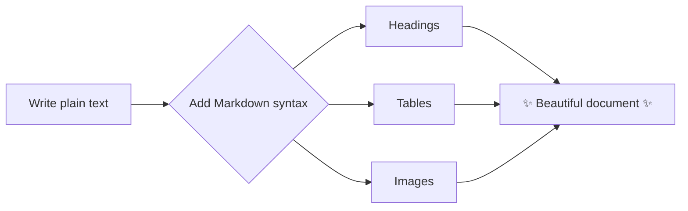
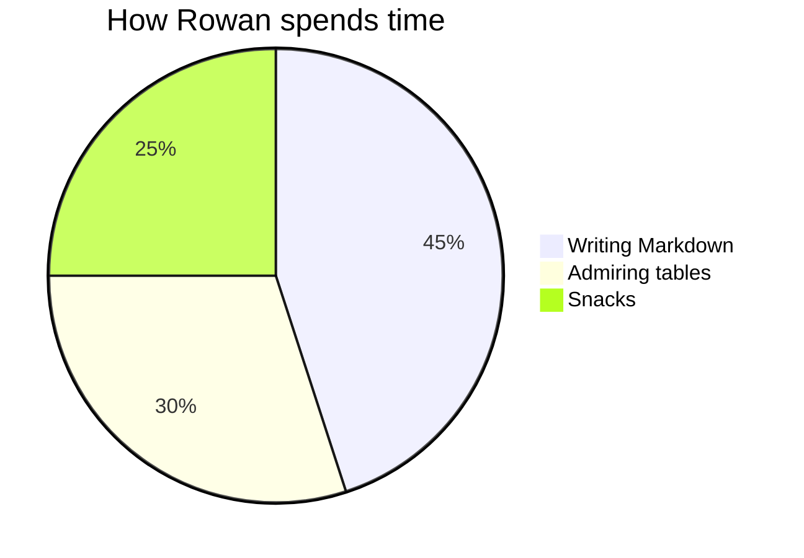

# 👋 Hey Rowan — Welcome to Markdown!


[](https://commonmark.org)
[](https://www.markdownguide.org)


> This file is a tour of what Markdown can do. Open it in a viewer that renders Markdown
> (GitHub, VS Code preview, Obsidian, Typora, etc.) to see it in its full glory.
> Then open it as plain text to see how simple the source is.

---

## 📑 Table of Contents

1. [Headings](#-headings)
2. [Text Formatting](#-text-formatting)
3. [Lists](#-lists)
4. [Links](#-links)
5. [Images](#-images)
6. [Tables](#-tables)
7. [Code](#-code)
8. [Blockquotes & Callouts](#-blockquotes--callouts)
9. [Fancy Extras](#-fancy-extras)
10. [Diagrams & Math](#-diagrams--math)

---

## 🔠 Headings

# Heading 1
## Heading 2
### Heading 3
#### Heading 4
##### Heading 5
###### Heading 6

Alternate syntax for the big two:

Heading 1, underline style
==========================

Heading 2, underline style
--------------------------

---

## ✍️ Text Formatting

| What you type | What you get |
|---|---|
| `*italic*` or `_italic_` | *italic* |
| `**bold**` or `__bold__` | **bold** |
| `***bold italic***` | ***bold italic*** |
| `~~strikethrough~~` | ~~strikethrough~~ |
| `` `inline code` `` | `inline code` |
| `<kbd>Ctrl</kbd> + <kbd>C</kbd>` | <kbd>Ctrl</kbd> + <kbd>C</kbd> |
| `H<sub>2</sub>O` | H<sub>2</sub>O |
| `E = mc<sup>2</sup>` | E = mc<sup>2</sup> |
| `<mark>highlight</mark>` | <mark>highlight</mark> |

End a line with two spaces (or a backslash)\
to force a line break without starting a new paragraph.

Need a literal asterisk? Escape it: \*not italic\*, \# not a heading, \`not code\`.

---

## 📋 Lists

### Unordered
- Coffee ☕
- Tea 🍵
  - Green
  - Black
    - Earl Grey
    - English Breakfast
- Hot chocolate 🍫

### Ordered
1. Wake up
2. Read this file
3. Become a Markdown wizard 🧙
   1. Practice tables
   2. Show off to friends

> Fun fact: the actual numbers don't matter — `1. 1. 1.` still renders as 1, 2, 3.

### Task list (checkboxes)
- [x] Learn headings
- [x] Learn bold and italic
- [ ] Make a table from scratch
- [ ] Write a README for a project

---

## 🔗 Links

- Inline link: [CommonMark spec](https://commonmark.org)
- Link with a hover title: [Markdown Guide](https://www.markdownguide.org "The friendliest Markdown reference")
- Bare autolink: <https://github.github.com/gfm/>
- Reference-style link: the original [Markdown project][gruber] by John Gruber.
- Jump within this doc: [back to the top](#-hey-rowan--welcome-to-markdown)

[gruber]: https://daringfireball.net/projects/markdown/

---

## 🖼️ Images

A basic image:


An image that's also a link (click it!):

[](https://picsum.photos)

A custom placeholder image with text baked in:


Resized & centered using a bit of HTML (works on GitHub and most viewers):

<p align="center">
  
</p>

---

## 📊 Tables

### Basic table with column alignment

| Left-aligned | Centered | Right-aligned |
|:-------------|:--------:|--------------:|
| apples       | 🍎       | $1.20         |
| bananas      | 🍌       | $0.50         |
| cherries     | 🍒       | $4.75         |
| **Total**    |          | **$6.45**     |

### Comparison table

| Feature            | Plain text | Markdown | Word doc |
|--------------------|:----------:|:--------:|:--------:|
| Easy to write      | ✅         | ✅       | ⚠️       |
| Looks nice         | ❌         | ✅       | ✅       |
| Works in Git       | ✅         | ✅       | ❌       |
| Readable as source | ✅         | ✅       | ❌       |

> Tip: the pipes don't need to line up perfectly — Markdown is forgiving. Lining them up just makes the source prettier.

---

## 💻 Code

Inline: run `npm install` to get started.

A fenced code block with syntax highlighting:

```python
def greet(name: str) -> str:
    """Say hi to a friend."""
    return f"Hello, {name}! Welcome to Markdown. 🎉"

print(greet("Rowan"))
```

```javascript
const skills = ["headings", "tables", "images"];
skills.forEach((s) => console.log(`Rowan learned ${s}!`));
```

```bash
# Shell commands look great too
echo "Markdown is awesome" > notes.md
cat notes.md
```

```diff
- old boring plain text
+ shiny new formatted Markdown
```

```json
{
  "name": "Rowan",
  "markdownLevel": "expert",
  "favoriteFeature": "tables"
}
```

---

## 💬 Blockquotes & Callouts

> A plain blockquote.
>
> > And a nested one inside it.
>
> — Someone wise

GitHub-style alerts (render as colored callouts on GitHub):

> [!NOTE]
> Useful information that users should know.

> [!TIP]
> Use `Ctrl + Shift + V` in VS Code to preview Markdown.

> [!IMPORTANT]
> Key information users need to know.

> [!WARNING]
> Markdown can be addictive.

> [!CAUTION]
> Once you learn tables you'll never go back.

---

## ✨ Fancy Extras

### Collapsible section

<details>
<summary>🎁 Click to reveal a surprise</summary>

You found it! Collapsible sections are great for long logs, spoilers, or FAQs.

- They can contain **any** Markdown
- Even lists and code:

```text
¯\_(ツ)_/¯
```

</details>

### Footnotes

Markdown was created in 2004[^1] and is now used basically everywhere[^2].

[^1]: By John Gruber, with help from Aaron Swartz.
[^2]: README files, chat apps, note-taking apps, documentation sites, and more.

### Emoji shortcodes (GitHub, Slack, Discord)

:rocket: :tada: :sparkles: :coffee: :books:

### Horizontal rules

Three or more dashes, asterisks, or underscores:

***

___

---

## 📈 Diagrams & Math

### Mermaid diagram (renders on GitHub, Obsidian, many others)





### Math (LaTeX, supported on GitHub & Obsidian)

Inline math: $E = mc^2$

Block math:

$$
\sum_{n=1}^{\infty} \frac{1}{n^2} = \frac{\pi^2}{6}
$$

---

## 📚 Keep Learning

- [Markdown Guide — Basic Syntax](https://www.markdownguide.org/basic-syntax/)
- [Markdown Guide — Extended Syntax](https://www.markdownguide.org/extended-syntax/)
- [GitHub Flavored Markdown Spec](https://github.github.com/gfm/)
- [CommonMark Interactive Tutorial](https://commonmark.org/help/tutorial/)

<p align="center"><sub>Made with ❤️ and a lot of <code>#</code> symbols — happy writing, Rowan!</sub></p>